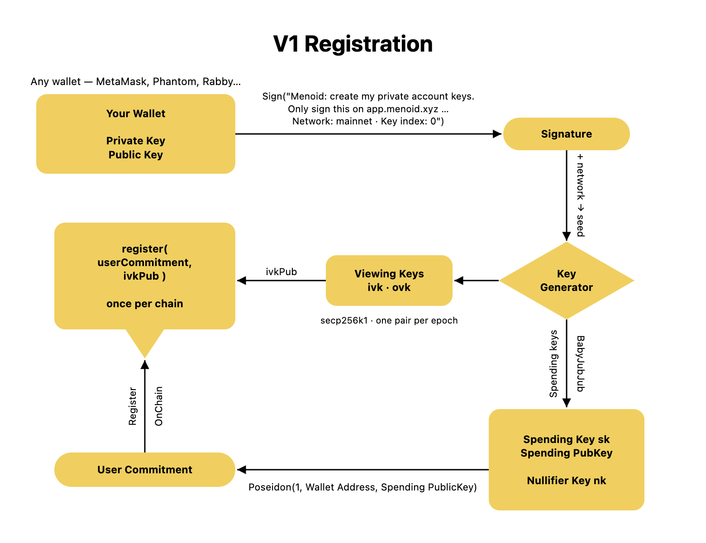
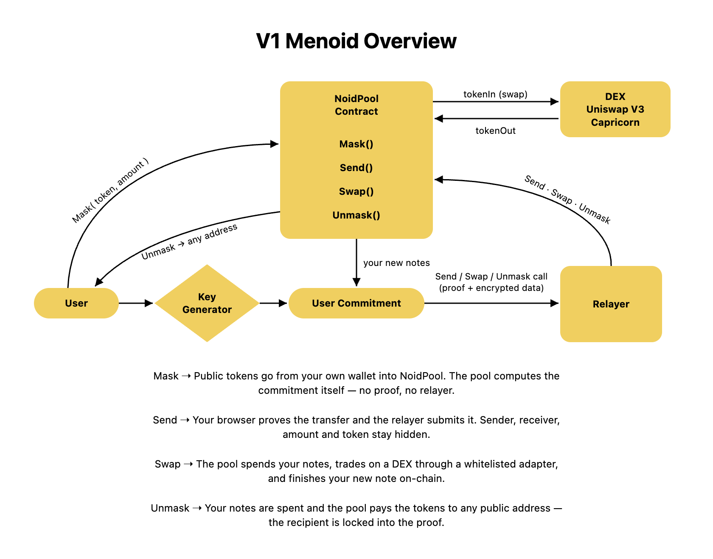
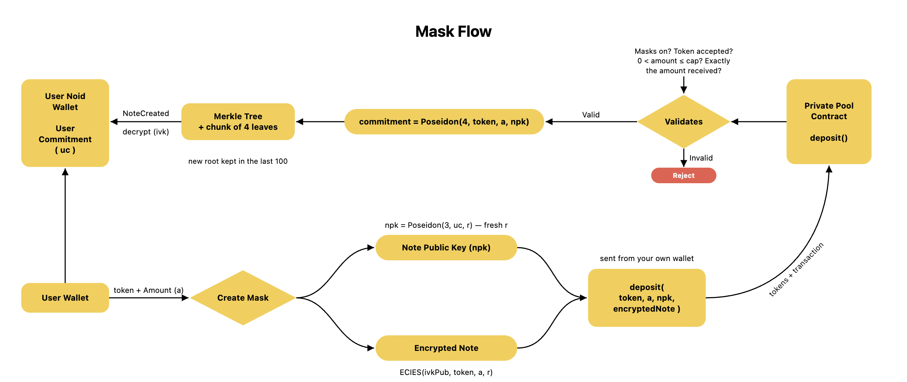
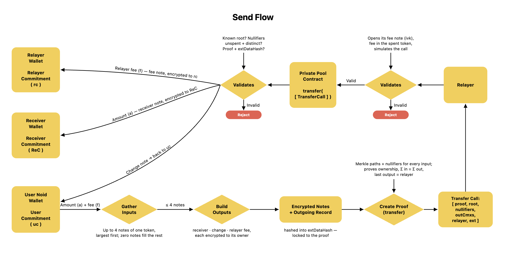
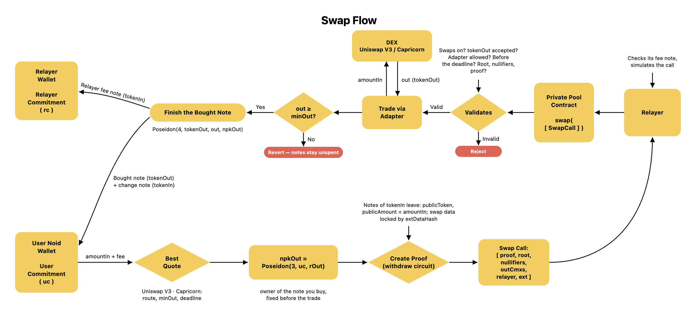
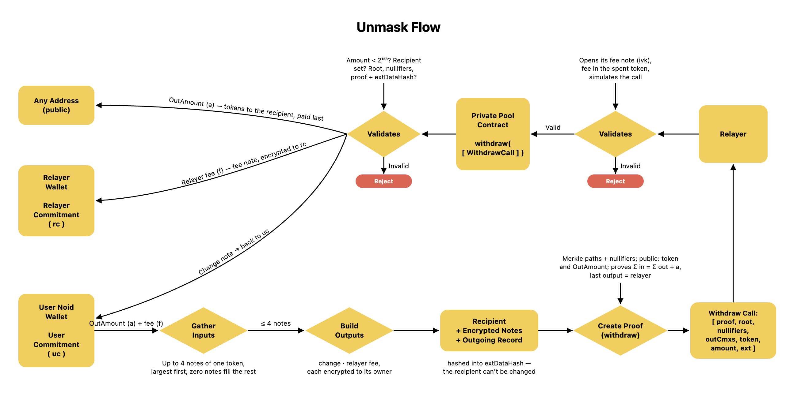
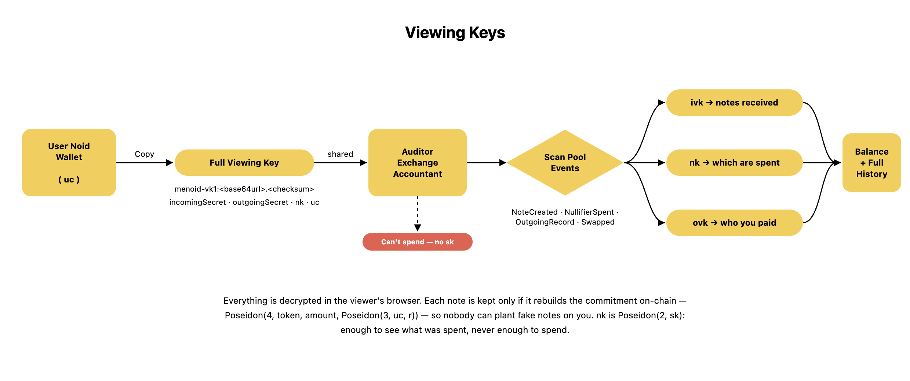

# 🔐 Menoid V1 — Protocol Documentation

> **V1 is Menoid on mainnet** — a private app in your browser at **[app.menoid.xyz](https://app.menoid.xyz)**,
> live on **Monad** and **Base**. Mask, send, swap and unmask privately, and share a viewing key
> whenever you need to prove your activity.
>
> The testnet version — the browser extension and the Android app, on six testnets — is
> documented in the same layout in **[V0.5-DOCS.md](V0.5-DOCS.md)**.
>
> https://menoid.xyz

---

## Table of Contents

- [What is Menoid V1](#what-is-menoid-v1)
  - [Why Privacy Matters](#why-privacy-matters)
  - [Crypto is multi-chain. Privacy isn't.](#crypto-is-multi-chain-privacy-isnt)
  - [Introducing Menoid V1](#introducing-menoid-v1)
  - [Public Wallet vs Private Balance](#public-wallet-vs-private-balance)
  - [Privacy with Accountability](#privacy-with-accountability)
  - [What's Live](#whats-live)
  - [Coming Up](#coming-up)
- [Core Vocabulary](#core-vocabulary)
- [1. Registration](#1-registration)
- [2. Overview](#2-overview)
- [3. Mask](#3-mask)
- [4. Send](#4-send)
- [5. Swap](#5-swap)
- [6. Unmask](#6-unmask)
- [7. Viewing Keys](#7-viewing-keys)
- [Appendix A — Protocol Constants](#appendix-a--protocol-constants)
- [Appendix B — Formula Reference](#appendix-b--formula-reference)

---

# What is Menoid V1

## Why Privacy Matters

Privacy is a fundamental part of everyday life.

We close our doors, protect our passwords, and don't publicly share every financial decision we make. Yet in crypto, most activity remains completely transparent by default. A single wallet address can reveal transaction history, asset holdings, NFT collections, DeFi positions, and interactions across protocols. Anyone with access to a block explorer can follow this information indefinitely.

Privacy is not about hiding wrongdoing. It is about preserving choice, security, and personal freedom in a digital world.

## Crypto is multi-chain. Privacy isn't.

Today, users interact across more blockchains than ever before. They trade on one chain, hold assets on another, explore new ecosystems like Monad and Base, and use applications across countless networks.

Most privacy solutions, however, remain confined to individual ecosystems, or ask users to move to a new wallet and a new address to get any privacy at all.

**Users have become multi-chain. Privacy has not.**

## Introducing Menoid V1

Menoid is the **compliance-friendly multichain privacy layer**. V0.5 proved the idea as a wallet of its own, on six testnets. V1 takes it to mainnet in a different shape: **a privacy layer over the wallet you already use**.

There is nothing to install. You open [app.menoid.xyz](https://app.menoid.xyz), connect MetaMask, Phantom, Rabby or any other wallet, and sign one message. That signature becomes your private keys, inside the browser tab. From then on you can:

- **Mask** — move tokens from your public wallet into a shielded pool, as a private note.
- **Send** — pay any registered address privately: sender, receiver, amount and token stay hidden.
- **Swap** — trade privately inside the pool, on Uniswap V3 or Capricorn.
- **Unmask** — move private funds back to any public address.
- **Share a viewing key** — let someone you choose see your private activity, without letting them spend.

The goal is unchanged:

- **One identity.**
- **One privacy experience.**
- **Multiple chains.**

> This is not just a design goal — it is what the protocol does. The key message names no chain, so one signature gives you the same private identity on Monad and on Base, and the same commitment and nullifier formulas run on every V1 chain.

## Public Wallet vs Private Balance

V1 has no modes to switch. Your wallet stays exactly what it is — your **public wallet**. Menoid adds a **private balance** next to it, held as notes in the pool.

| | **🌍 Your public wallet** | **🌑 Your private balance** |
|---|---|---|
| **Balances** | Public — anyone can read them | Hidden — only your keys (or a viewing key you share) can compute it |
| **Transfers** | Public transfers | Private sends — sender, receiver, amount and token hidden |
| **Swaps** | Public swaps | Private swaps — who swapped, and where the output went, hidden |
| **History** | Permanently traceable | Unlinkable on-chain; readable only with a viewing key |
| **Address** | Your address | **The same address** — people pay you at your normal address |
| **Keys** | Your wallet's key | Derived from one signature of that wallet — nothing new to back up |

Moving between the two is a transaction, not a migration: **Mask** moves tokens in, **Unmask** moves them out.

## Privacy with Accountability

Privacy should not require users to choose between confidentiality and transparency.

In V1 this is not only a design idea but a working feature: **viewing keys**. A full viewing key lets an auditor, an exchange or an accountant see everything you received, spent and paid — and it can never spend. Nobody else holds such a key: there is no protocol key and no "regulator" key; the only keys that exist are yours.

Rather than exposing financial activity to everyone by default, Menoid enables **privacy as the default and transparency as a choice**. See [7. Viewing Keys](#7-viewing-keys).

## What's Live

| | |
|---|---|
| **Chains** | Monad (chain 143) and Base (chain 8453) |
| **App** | [app.menoid.xyz](https://app.menoid.xyz) — the testnets (Monad testnet, Base Sepolia) run at [testnet.menoid.xyz](https://testnet.menoid.xyz) with separate keys |
| **Private actions** | Mask · Send · Swap · Unmask · Viewing keys |
| **Tokens** | 28 on Monad (14 memecoins among them) · 50 on Base (20 memecoins among them) |
| **Swap venues** | Uniswap V3 on both chains · Capricorn (nad.fun's DEX) on Monad |
| **Proofs** | Groth16, made in your browser, against a trusted setup with a public phase 1 and Menoid's own phase 2 |

Contract addresses are in [Appendix A](#contracts).

## Coming Up

| Release | Description | Network |
|---|---|---|
| **V0.5** ✅ | The demo — the browser extension and the Android app, with Open Mode and Noid Mode. See [V0.5-DOCS.md](V0.5-DOCS.md). | 6 testnets |
| **V1** 🟢 live | The private web app at [app.menoid.xyz](https://app.menoid.xyz): mask, send, swap and unmask privately, with viewing keys. This document. | Monad · Base |
| **V2** | Revealed in the future. | Mainnet |

---

# Core Vocabulary

These terms appear throughout every section. Each section below also re-defines the terms specific to its own diagram.

| Term | Definition |
|---|---|
| **Public Wallet** | The wallet you already use (MetaMask, Phantom, Rabby…). The only address you ever see or share. |
| **Private Balance** | The sum of your unspent notes in the pool. Only your keys — or a viewing key you share — can compute it. |
| **Key Message** | The readable message your wallet signs once. It names the site, the network and a key index. |
| **Seed** | `keccak256` of a tag, the network and that signature. Every key comes from it; it is never stored or sent. |
| **Spending Key (sk)** | A BabyJubJub scalar. Proves ownership inside a proof. Never leaves the browser. |
| **Nullifier Key (nk)** | `Poseidon(2, sk)`. Computes nullifiers. It can be shared (in a viewing key) without giving away `sk`. |
| **Viewing Keys (ivk, ovk)** | One pair per viewing epoch. `ivk` (secp256k1) opens notes sent to you; `ovk` opens your own records of payments you made. |
| **User Commitment (uc)** | `Poseidon(1, address, spendPk.x, spendPk.y)`. Your private identity, registered on-chain. |
| **Note** | A private UTXO: a token, an amount and a random number, owned by a user commitment. |
| **Note Public Key (npk)** | `Poseidon(3, uc, r)`. A note's owner, blinded by that note's own randomness. |
| **Commitment (cm)** | `Poseidon(4, token, amount, npk)`. A note's public fingerprint — one leaf of the Merkle tree. |
| **Nullifier (nf)** | `Poseidon(5, nk, commitment, r)`. Published when a note is spent, to prevent double spends. Only the owner can compute it. |
| **Encrypted Note** | A note's contents, encrypted (ECIES) to its owner's viewing key and emitted in `NoteCreated`. |
| **Outgoing Record** | The sender's own encrypted record of a spend — who was paid, how much, the fee — readable with `ovk`. |
| **extDataHash** | One public input of a proof that locks everything outside the circuit — encrypted notes, the recipient, swap data — to the proof. |
| **NoidPool** | The pool contract: one per chain, holding every token, keeping the Merkle trees, verifying the proofs. |
| **Relayer** | The service that submits sends, swaps and unmasks and pays their gas, so your address never touches them. Paid with a private fee note. |
| **Adapter** | A whitelisted contract the pool trades through: `UniswapV3Adapter` (Uniswap V3) or `V3PoolAdapter` (Capricorn). |
| **ZK-Proof** | A Groth16 proof, made in your browser. Proves the rules were followed without revealing the private values. |
| **Poseidon** | A ZK-friendly hash. Every Menoid hash starts with a domain separator (1 to 5), so no hash can be mistaken for another. |
| **Merkle Tree** | An append-only tree of commitments. Proving your note is in it proves it exists without saying which note is yours. |
| **Public Signals** | The inputs to a proof that are visible on-chain. Everything else stays private. |

---

# 1. Registration



Registration is the one-time step that gives your public wallet a private identity on a chain. It happens once per wallet, per chain, and everything after it — mask, send, swap, unmask — depends on it.

## Definitions for this section

| Term | Definition |
|---|---|
| **Your Wallet** | Any wallet you already use. Its private key never leaves it; Menoid only ever asks it to **sign**. |
| **Sign(key message)** | One signature over a readable message (below). This is a signature, not a transaction — it costs no gas and touches no chain. |
| **Signature** | 65 bytes. Standard wallets sign deterministically (RFC 6979), so the same wallet always produces the same signature — which makes it usable as a **seed**. |
| **+ network → seed** | The network name is mixed into the seed as well as signed, so mainnet and testnet keys are unrelated. |
| **Key Generator** | The pure function that expands the seed into every key. Deterministic: same signature in, same keys out, forever. It runs in the browser tab. |
| **Spending Key sk / Spending PubKey** | The **BabyJubJub** keypair. `sk` authorizes spending inside proofs; `spendPk = sk · Base8` is its public point `(x, y)`. |
| **Nullifier Key nk** | `Poseidon(2, sk)` — computes nullifiers; one-way, so it can be shared without giving away `sk`. |
| **Viewing Keys ivk · ovk** | secp256k1 incoming key pair and symmetric outgoing key, one set per viewing epoch. |
| **User Commitment** | `Poseidon(1, Wallet Address, Spending PublicKey.x, Spending PublicKey.y)` — the single value that represents you in the pool. |
| **register(userCommitment, ivkPub)** | The one-time transaction, from your own wallet, that stores your identity and your viewing public key on-chain. |

## The key message

```
Menoid: create my private account keys.

Only sign this on https://app.menoid.xyz
Anyone holding this signature can spend your private balance.

Network: mainnet
Key index: 0
```

Every line has a job:

- **It names the only site that should ask for it.** A phishing page asking for this signature looks wrong at a glance.
- **It names the network.** [testnet.menoid.xyz](https://testnet.menoid.xyz) asks for the same message with its own origin and `Network: testnet` — and the keys come out completely unrelated.
- **It names a key index**, `0` to start. `rotateKeys` moves you to the next one (see below).
- **It names no chain.** One signature, one identity on every V1 chain.

## How the derivation works

```
                    sign(key message)
   Your Wallet  ──────────────────────►  signature
                                              │
                                              ▼
              seed = keccak256("menoid/v1m/seed" ‖ network ‖ signature)     ← memory only
                                              │
          ┌───────────────────────────────────┼───────────────────────────────────┐
          ▼                                   ▼                                   ▼
   Spending                           Incoming viewing                    Outgoing viewing
   sk      = H("…/spend", seed) mod l  incomingSecret = H("…/incoming",    outgoingSecret = H("…/outgoing",
   spendPk = sk · Base8                                  seed)                                  seed)
   nk      = Poseidon(2, sk)           ivk(e) = H("…/ivk", incomingSecret, e)  ovk(e) = H("…/ovk", outgoingSecret, e)
          │                            ivkPub(e) = ivk(e) · G
          ▼
   userCommitment = Poseidon(1, address, spendPk.x, spendPk.y)
          │
          ▼
   register(userCommitment, ivkPub(0))                ← one-time, on-chain, per chain
```

Exactly:

```
seed           = keccak256("menoid/v1m/seed" ‖ network ‖ signature)
sk             = keccak256("menoid/v1m/spend" ‖ seed) mod l           // BabyJubJub scalar
spendPk        = sk · Base8                                           // BabyJubJub point (x, y)
nk             = Poseidon(2, sk)                                      // nullifier key
incomingSecret = keccak256("menoid/v1m/incoming" ‖ seed)
outgoingSecret = keccak256("menoid/v1m/outgoing" ‖ seed)
ivk(e)         = keccak256("menoid/v1m/ivk" ‖ incomingSecret ‖ e) mod (n − 1) + 1
ivkPub(e)      = ivk(e) · G                                           // secp256k1, 65 bytes: 0x04 ‖ X ‖ Y
ovk(e)         = keccak256("menoid/v1m/ovk" ‖ outgoingSecret ‖ e)
userCommitment = Poseidon(1, address, spendPk.x, spendPk.y)
```

Where `‖` is Solidity's packed encoding (`solidityPackedKeccak256`), `l` is the BabyJubJub prime subgroup order, `n` is the secp256k1 group order, and `e` is the viewing epoch (a `uint32`, starting at 0):

```
l = 2736030358979909402780800718157159386076813972158567259200215660948447373041
n = 0xfffffffffffffffffffffffffffffffebaaedce6af48a03bbfd25e8cd0364141
```

The tags — `menoid/v1m/spend`, `…/incoming`, `…/outgoing`, `…/ivk`, `…/ovk` — keep every key independent: learning one tells you nothing about the others. The `mod (n − 1) + 1` keeps `ivk` inside `[1, n − 1]`, so it is always a valid secp256k1 private key.

## The keys, and why there are three kinds

| | **Spending** (`sk`, `spendPk`, `nk`) | **Incoming viewing** (`ivk`, `ivkPub`) | **Outgoing viewing** (`ovk`) |
|---|---|---|---|
| **Type** | BabyJubJub scalar and point; `nk` is a Poseidon hash | secp256k1 key pair | 32-byte symmetric key |
| **Job** | Prove ownership inside a proof; `nk` makes nullifiers | Decrypt the notes others send you (ECIES) | Decrypt your own record of each payment you made |
| **On-chain?** | Only inside the user commitment | `ivkPub` is registered | Never |
| **Shareable?** | `sk`: never. `nk`: inside a viewing key | Yes — inside a viewing key | Yes — inside a viewing key |
| **Changes with** | the key index | the viewing epoch | the viewing epoch |

They are separate because they need different powers. The spending key lives inside the arithmetic of a proof. The viewing keys live in ordinary software, opening notes and records. V0.5 had two key pairs; V1 splits the nullifier job out of `sk` into `nk` and adds `ovk` — the two changes that make real viewing keys possible.

## The User Commitment

```
userCommitment = Poseidon(1, address, spendPk.x, spendPk.y)
```

This one value carries the whole design:

- **It contains your real address**, which is why other users can pay you by simply typing your normal wallet address. The sender reads `registrationOf(yourAddress)` on-chain and locks the note to whatever commitment they find. No special "private address" is ever exchanged.
- **It contains your spending public key**, which is what makes it *yours*. Inside a circuit, the prover supplies `sk` and the owner address, recomputes `spendPk = sk · Base8`, and then recomputes the user commitment. If the result doesn't match the one the notes are locked to, the proof fails. Knowing someone's address is not enough to spend their notes — you would need their `sk`.
- **It is a hash**, so publishing it reveals neither your keys nor anything about your holdings.
- **The leading `1` is a domain separator.** No other Menoid hash can ever produce a user commitment.

## Register on-chain

```solidity
function register(bytes32 userCommitment, bytes calldata viewingPublicKey) external {
    require(_registrations[msg.sender].userCommitment == bytes32(0), "Already registered");
    _claimUserCommitment(userCommitment);   // non-zero, inside the field, not claimed by another address
    _checkViewingKey(viewingPublicKey);     // 65 bytes, starting with 0x04

    Registration storage reg = _registrations[msg.sender];
    reg.userCommitment = userCommitment;
    reg.viewingPublicKey = viewingPublicKey;

    emit Registered(msg.sender, userCommitment, viewingPublicKey);
}
```

- **Once per address.** A second `register()` from the same address reverts with `Already registered`. Keys move on only through `updateViewingKey` and `rotateKeys`, below.
- **Called by the real wallet.** `msg.sender` *is* the binding. There is no way to register a commitment on behalf of an address you don't control.
- **A commitment can be claimed once.** An honest commitment contains its own address, so two wallets never collide; the contract refuses a copied one (`User commitment already claimed`).
- **The relayer registers too** — like any user, with its own key message and its own identity. Every proof names the relayer's user commitment as the owner of its fee note; nothing in the contract fixes who the relayer is.

### One read, both values

```
registrationOf(address) → (userCommitment, viewingPublicKey, keyIndex, viewingEpoch)
```

A sender needs **two** things about a receiver, and one cannot be derived from the other:

| | what it does |
|---|---|
| `userCommitment` | locks the note to the receiver |
| `viewingPublicKey` | encrypts the note so only the receiver can read it |

Both come from **one read on the chain**, so no server sits on the path of a privacy decision (the lesson V0.5 learned — see [V0.5-DOCS.md](V0.5-DOCS.md#why-the-encryption-key-goes-on-chain-too)). An address that never registered answers zeros; the app then offers the public route — an unmask straight into their wallet — and says so before you confirm.

### Changing keys later

| Function | What changes | When to use it |
|---|---|---|
| `updateViewingKey(ivkPub)` | Viewing epoch + 1: senders encrypt new notes to a new `ivkPub`. Same identity, same balance. | Start a fresh viewing period — for example after sharing an epoch key. |
| `rotateKeys(uc, ivkPub)` | Key index + 1: a whole new identity (new `sk`, `nk`, `ivk`, `ovk`). | If your signature ever leaked. Notes locked to the old identity still need the old keys. |

## What registration reveals — and what it doesn't

Registration is a public transaction, so it is observable that a given address uses Menoid, and its user commitment and viewing **public** key are readable by anyone. That is all it says. It does not reveal:

- your spending key, your nullifier key, or your viewing **private** keys,
- your balance (you have none in the pool yet),
- any past, present, or future activity inside the pool.

## Why derive from a signature instead of generating a new wallet?

- **No second address.** You only ever see and share your real address.
- **No second seed phrase.** There is nothing extra to back up.
- **No extension to install.** Any wallet that can sign a message works.
- **Deterministic recovery.** Open the app on a new device, sign the key message again, and the identical keys reappear. Your notes are rebuilt from chain events alone.
- **Same identity on every chain.** The message names no chain, so Monad and Base see the same user commitment.

> **⚠️ The signature is the master secret.** Anyone who obtains it can derive `sk` and spend every note you own. The app keeps it in memory, in that tab only, and never sends it anywhere — reload and you sign again. Sign the Menoid key message only on **app.menoid.xyz** (or testnet.menoid.xyz for testnet keys).

---

# 2. Overview



With registration done, you have a private identity. This section is the map of the whole system: four operations against one contract, a relayer standing between you and the chain for three of them, and a DEX for one.

## Definitions for this section

| Term | Definition |
|---|---|
| **User** | The person, holding a public wallet with public funds. |
| **Key Generator** | The derivation from Section 1, which turns the user's signature into their keys. |
| **User Commitment** | The user's private identity. Everything the user owns inside the pool is locked to this value. |
| **NoidPool Contract** | The shielded pool, one per chain. It holds the funds of every token and exposes four operations — `Mask()`, `Send()`, `Swap()`, `Unmask()` (`deposit`, `transfer`, `swap` and `withdraw` in the contract). |
| **Relayer** | The party that submits sends, swaps and unmasks and pays the gas for them. |
| **DEX** | Where the pool trades for a swap — Uniswap V3, or Capricorn on Monad — always through a whitelisted adapter. |
| **ZK-Proof** | The Groth16 proof accompanying every send, swap and unmask; the contract's only means of deciding whether a spend is legitimate. |

## The four operations

**Mask** → The user moves tokens from their public wallet into the pool. The pool computes the note's commitment itself from the tokens it actually received — no proof, no relayer.

**Send** → The sender's browser proves the transfer and hands it to the relayer, which submits it. Sender, receiver, amount and token are never revealed.

**Swap** → The sender's browser proves that some notes of one token leave the private balance; the relayer submits it; the pool itself trades on a DEX and finishes a new private note of the other token.

**Unmask** → The user proves a withdrawal to a receiving address and hands it to the relayer, which submits it. The receiving address receives the tokens.

| Operation | Contract call | Proof | Sent by |
|---|---|---|---|
| **Mask** | `deposit()` / `depositNative()` | none | your wallet |
| **Send** | `transfer(TransferCall[])` | `transfer_proof` | the relayer |
| **Swap** | `swap(SwapCall[])` | `withdraw_proof` | the relayer |
| **Unmask** | `withdraw(WithdrawCall[])` | `withdraw_proof` | the relayer |

Notice the asymmetry in the diagram: **Mask goes straight from the User to the contract**, while **Send, Swap and Unmask go through the Relayer**. That is deliberate, and the reason is below.

## One pool, every token

V0.5 kept one pool per chain for its native coin. V1 keeps **every token in one pool and one Merkle tree**: the token is a private field inside the commitment. A private send of USDC and a private send of MON look the same on-chain — the token is not even a public signal of the transfer proof.

## The UTXO model

Menoid does not store account balances. There is no `balances[user]` mapping anywhere — such a mapping would either leak everything or be unusable.

Instead, value exists as **notes**, in the style of Bitcoin's UTXOs:

```
note        = (token, amount, r)  owned by  userCommitment
npk         = Poseidon(3, userCommitment, r)        ← the owner, blinded by this note's randomness
commitment  = Poseidon(4, token, amount, npk)       ← this is what the chain stores
nullifier   = Poseidon(5, nk, commitment, r)        ← this is published when it is spent
```

Consequences of this model:

- **Your balance is the sum of your unspent notes**, computed by your browser locally. Nobody else can compute it — unless you give them a viewing key.
- **Notes are consumed whole.** Spending a 10 USDC note to send 4 USDC means creating a 4 USDC note for the receiver, a **change** note back to yourself, and a small fee note for the relayer — exactly like breaking a banknote.
- **Every note is spent exactly once.** The nullifier enforces this.

The numbers in front are **domain separators**. They ensure no hash can ever be reinterpreted as another kind, even with identical inputs:

| Tag | Hash | Gives you |
|---|---|---|
| 1 | `Poseidon(1, address, spendPk.x, spendPk.y)` | userCommitment |
| 2 | `Poseidon(2, sk)` | nk — the nullifier key |
| 3 | `Poseidon(3, userCommitment, r)` | npk — the note public key |
| 4 | `Poseidon(4, token, amount, npk)` | commitment |
| 5 | `Poseidon(5, nk, commitment, r)` | nullifier |

## What is public and what is private

| Public on-chain | Private (never on-chain) |
|---|---|
| That an address registered, its user commitment and viewing public key | Your spending, nullifier and viewing private keys |
| Commitments, nullifiers and Merkle roots (opaque hashes) | Note owners, amounts, tokens and randomness |
| Encrypted notes and outgoing records (unreadable without a viewing key) | Which commitment belongs to whom |
| Mask: the depositing address, token and amount | Which nullifier cancels which commitment |
| Unmask: the token, amount and receiving address | Sender, receiver, amount and token of any send |
| Swap: the token pair, both amounts and the adapter | Who swapped, and who owns the note that was bought |
| | The link between a mask and an unmask |

The rows worth dwelling on are the edges. **Entering and leaving the pool are public events**, and so is a trade on a DEX — real tokens visibly move. What Menoid hides is everything in between: once inside, there is no on-chain link between the mask that funded a note and the unmask or swap that eventually spends it.

## Why a relayer

If a user submitted their own send, they would pay gas from their public address — and that address, appearing in the same transaction that spends a note, links the public identity to the private activity. The proof would be perfectly sound and the privacy would be gone.

So the relayer submits instead:

- **The relayer pays the gas**, so the user's address never appears.
- **The relayer is paid with a private fee note** in the token being spent — the last output of every proof, locked to the relayer's own user commitment. Its price is the relayer's real gas cost plus a small margin.
- **The relayer cannot steal.** It never learns amounts, cannot forge proofs, and cannot redirect funds: the recipient, the encrypted notes and the swap data are all hashed into the proof's `extDataHash`, so changing any of them makes verification fail.
- **The relayer cannot censor selectively** based on content, because it cannot see the content.
- **The relayer validates locally first** — it opens its fee note, checks it, and simulates the call — before spending its own gas.
- **Anyone can relay.** A proof names the relayer that gets the fee; the contract does not care who submits it.

The relayer is a convenience and a privacy amplifier, not a source of trust. The worst it can do is refuse to serve you.

## How a wallet finds its own notes

Nothing on-chain says which notes are yours. Your browser works it out by itself:

1. Download every `NoteCreated`, `NullifierSpent`, `OutgoingRecord` and `Swapped` event. Everyone downloads everything, so nothing reveals which notes you are looking for.
2. Derive `ivk` and `ovk` for every viewing epoch, from 0 to the current one.
3. Attempt ECIES decryption of each `encryptedNote` with each `ivk`. Failures are ignored — this is *trial decryption*, and a failure simply means the note isn't yours.
4. On success, confirm ownership by recomputing `Poseidon(4, token, amount, Poseidon(3, yourUserCommitment, r))` and checking it equals the emitted commitment. This defends against someone emitting a note you can decrypt but don't actually own. Zero-value notes — the dummies of fixed-shape spends — are skipped.
5. Compute each note's nullifier with `nk` and check it against the `NullifierSpent` events. If it has been spent, skip it.
6. Whatever survives is your unspent note set. Their sum, per token, is your balance.

The encrypted notes are emitted as **events rather than stored in contract storage**: events are dramatically cheaper in gas, and the data only ever needs to be read by wallets, never by the contract.

---

# 3. Mask



Mask is the doorway from your public wallet into your private balance. Public tokens go in; one private note comes out.

## Definitions for this section

| Term | Definition |
|---|---|
| **User Wallet** | Your public wallet, sending `token` and `Amount (a)`. Its address is public on this transaction. |
| **Create Mask** | The browser's local step: pick the randomness, build the note public key, encrypt the note. All off-chain. |
| **r** | 31 fresh random bytes ("randomness", or blinding factor). It makes the commitment unique and unguessable. |
| **Note Public Key (npk)** | `Poseidon(3, uc, r)` — the owner of the new note, blinded by `r`. |
| **Encrypted Note** | `ECIES(ivkPub, version ‖ flags ‖ token ‖ a ‖ r)` — the note's contents, sealed to your own viewing key. |
| **deposit(token, a, npk, encryptedNote)** | The contract entry point, called **by your own wallet**. For MON or ETH: `depositNative(npk, encryptedNote)` with the coins attached. |
| **Validates** | The contract's checks: masks not paused, token accepted, `0 < a ≤ cap`, exactly `a` received. |
| **commitment** | `Poseidon(4, token, a, npk)` — **computed by the contract** from the tokens it actually received. |
| **Merkle Tree** | The pool's tree; every operation inserts one chunk of 4 leaves. |
| **NoteCreated** | The event that carries the commitment and the encrypted note; your browser decrypts it with `ivk`. |

## Off-chain: Create Mask

You want to mask `a` of `token`:

```
Choose:        token, a
Randomness:    r                                   ← 31 fresh random bytes, never reused
Your keys:     uc, ivkPub                          ← derived from your signature

npk            = Poseidon(3, uc, r)
encryptedNote  = ECIES(ivkPub, version ‖ flags ‖ token ‖ a ‖ r)     ← 70-byte plaintext

Send:          approve(pool, a)                    ← ERC-20 only, and only if the allowance is short
               deposit(token, a, npk, encryptedNote)
          or   depositNative(npk, encryptedNote)  { value: a }      ← MON / ETH
```

Two details do a lot of work here:

- **`r` must be fresh.** Without randomness, every 5-USDC note to the same person would be identical — instantly linkable, and guessable by trying plausible amounts. The randomness is what makes a commitment *hiding*. The contract also rejects a commitment that already exists.
- **You can mask to anyone.** The contract does not check whose `npk` it receives, so a mask can fund someone else's private balance. The app masks to you.

## Why a mask needs no proof

V0.5 proved every deposit, because the depositor split the public amount between a hidden note and a hidden fee note, and the circuit had to show nothing was invented. V1 removes the reason for the proof: **the contract computes the commitment itself**, from the token and the amount it actually received. The only value you supply is `npk` — which decides who owns the note and cannot add value. A note can never be worth more than what was masked.

That also makes a mask fee-free: no relayer is involved (your wallet pays the gas), so no fee note is created.

## On-chain: deposit()

```solidity
function deposit(address token, uint256 amount, bytes32 npk, bytes calldata encryptedNote) external nonReentrant {
    _checkDeposit(token, amount);   // not paused · token accepted · amount != 0 · amount <= maxDeposit

    uint256 balanceBefore = IERC20(token).balanceOf(address(this));
    IERC20(token).safeTransferFrom(msg.sender, address(this), amount);
    // a note must be backed 1:1 (rejects fee-on-transfer tokens)
    require(IERC20(token).balanceOf(address(this)) - balanceBefore == amount, "Token transfer amount mismatch");

    _depositNote(token, amount, npk, encryptedNote);
}

function _depositNote(address token, uint256 amount, bytes32 npk, bytes calldata encryptedNote) private {
    require(npk != bytes32(0) && uint256(npk) < FIELD_SIZE, "Invalid note public key");
    bytes32 commitment = bytes32(PoseidonT5.hash([D_CM, uint256(uint160(token)), amount, uint256(npk)]));
    bytes32[4] memory chunk;
    chunk[0] = commitment;
    (uint256 treeId, uint256 startIndex) = _insertChunk(chunk, 1);
    emit NoteCreated(treeId, startIndex, commitment, encryptedNote);
    emit Deposited(msg.sender, token, amount, commitment);
}
```

The contract, in order:

1. **Checks the mask is allowed:** masks not paused, the token accepted, `0 < amount ≤ maxDeposit` (each token has a per-mask cap).
2. **Pulls the tokens** and checks its balance grew by **exactly** `amount`. Tokens that skim a fee on transfer are refused. `depositNative` wraps the coins instead (MON → WMON, ETH → WETH).
3. **Checks `npk`** is non-zero and inside the field.
4. **Computes the commitment itself:** `Poseidon(4, token, amount, npk)`.
5. **Rejects a duplicate commitment** via the global `commitmentExists` map.
6. **Inserts it** into the current tree as one chunk of 4 leaves (the note and 3 empty leaves) and records the new root.
7. **Emits `NoteCreated(treeId, leafIndex, commitment, encryptedNote)`** — the event your browser will decrypt — and `Deposited(depositor, token, amount, commitment)`.

The tokens simply stay in the contract. From here on, ownership is tracked entirely by commitments.

## The Merkle tree

Each tree is an **incremental Merkle tree** of depth 20 — 2²⁰ = 1,048,576 leaves. When a tree fills, the contract opens a new one automatically (`NewTree(treeId)`) and keeps going; a proof names the tree its notes live in.

Three details are worth understanding:

- **Chunks of 4.** Every operation inserts exactly one aligned chunk of 4 leaves: 1 note for a mask, 3 for a send or a swap, 2 for an unmask, with empty leaves (`0`) filling the rest. The chunk's own 2-level subtree is hashed first, then the path above it.
- **`filledSubtrees`.** A naive insertion would rehash the entire tree. Instead the contract stores the latest filled *left* subtree at each level, so a chunk costs a fixed ~21 Poseidon hashes rather than a rebuild.
- **The root history.** Each tree remembers its **last 100 roots**, all accepted as valid. You build a proof against the root as it is now, but by the time your transaction is mined, other people's operations may have moved the root. A hundred roots of tolerance absorbs that; a proof left sitting for too long must simply be made again.

## What a mask reveals

A mask publicly shows **your address, the token, the amount and the moment** — tokens visibly leave your wallet. It does not reveal when that note is spent, or where its value goes: the note's nullifier cannot be linked back to its commitment.

> **Monad note:** on Monad, an account with code — including a MetaMask smart account (EIP-7702) — must keep 10 MON after every transaction it sends. The app knows, and shows how much you can mask.

---

# 4. Send



Send moves value between users entirely inside the pool. No tokens enter, no tokens leave, and neither party is revealed — not even the token. This is the operation Menoid exists for.

## Definitions for this section

| Term | Definition |
|---|---|
| **User Noid Wallet / User Commitment (uc)** | The sender: their private identity and the notes locked to it. |
| **Receiver Wallet / Receiver Commitment (ReC)** | The receiver, addressed by their **normal wallet address**; the app resolves it to their registered commitment and viewing key. |
| **Relayer Wallet / Relayer Commitment (rc)** | The relayer's identity, and the owner of the fee note. |
| **Amount (a) + fee (f)** | What the sender must cover: the amount to send, plus the relayer's fee, both in the token being sent. |
| **Gather Inputs** | Selecting up to 4 unspent notes of that token, largest first, until they cover `a + f`. Zero-value dummy notes fill any empty slot. |
| **Build Outputs** | The 3 output notes — receiver, change, relayer fee — each encrypted to its owner. |
| **Outgoing Record** | The sender's own encrypted record of the payment, readable with their `ovk`. |
| **extDataHash** | The hash that locks the encrypted outputs and the outgoing record to the proof. |
| **Transfer Call** | One proof and its data: `[proof, treeId, root, nullifiers, outCommitments, relayer, ext]`. |
| **Validates** | Two independent checks: the **relayer** validates locally (is its fee note real and enough? does the call simulate?), then the **contract** validates authoritatively (known root? unspent, distinct nullifiers? does the proof verify?). |

## Off-chain: gather, build, prove

**1. Resolve the receiver.** `registrationOf(receiverAddress)` → their user commitment and viewing public key. If they never registered, the app offers an unmask straight into their wallet instead.

**2. Get the fee.** The relayer quotes its fee in the token being sent — its real gas cost plus a small margin.

**3. Gather Inputs.** Notes are indivisible, so the browser collects unspent notes of that token — largest first, all from one tree — until they cover `a + f`. The circuit always consumes **exactly 4 input slots** (`N_INS = 4`); unused slots get **zero-value dummy notes**, which skip the Merkle check but still publish a random-looking nullifier.

**4. Build Outputs.** The circuit always produces **exactly 3 output notes**, in a fixed order:

| Output | Owner | Purpose |
|---|---|---|
| **out[0]** | Receiver (ReC) | The amount being sent |
| **out[1]** | Sender (uc) | The change |
| **out[2]** | Relayer (rc) | The fee — always last |

Each output is encrypted to its owner's viewing key, and the sender writes an **outgoing record** — `"sent a of token to the receiver, fee f"` — encrypted with their `ovk`.

**5. Lock the extra data.**

```
extDataHash = keccak256(abi.encode(chainId, pool, keccak256("menoid.v1m.transfer"),
                                   [encryptedOutputs[3], outgoingRecord])) mod p
```

**6. Create the Proof** — Merkle paths and nullifiers for every input, then a Groth16 proof with the transfer circuit, in the browser.

If the payment needs more than 4 notes, the browser splits it into **up to 4 Transfer Calls** relayed together in one transaction. Every call pays its own fee note. And because a 1-input send and a 4-input send produce **identically shaped proofs**, the proof never leaks how many notes you spent.

## The transfer proof

Transfer and withdraw share one core circuit, `SpendCore`, written once so a fix can never land in one and miss the other:

```circom
// ─── OWNERSHIP ───
component keys = OwnerKeys();                // sk → spendPk → userCommitment (with ownerAddress), and nk
keys.sk <== sk;
keys.ownerAddress <== ownerAddress;

// ─── PER INPUT NOTE (×4) ───
inRange[i] = RangeCheck(128);                // 0 <= amount < 2^128
inNote[i].token <== token;                   // one token for every note of the proof
inNote[i].owner <== keys.userCommitment;     // the note is locked to the prover's own identity
inNullifier[i].nullifier === nullifiers[i];  // Poseidon(5, nk, commitment, r)
(1 - inIsDummy[i].out) * (inPath[i].computedRoot - root) === 0;   // a real note (amount != 0) is in the tree

// ─── PER OUTPUT NOTE (×3) ───
outRange[i] = RangeCheck(128);
outNote[i].commitment === outCommitments[i]; // Poseidon(4, token, amount, Poseidon(3, owner, r))

outOwners[nOuts - 1] === relayer;            // the last output is always the relayer's fee

// ─── CONSERVATION ───
inSum[nIns] === outSum[nOuts] + publicAmount;   // publicAmount = 0 for a send
```

Read as English, one proof simultaneously establishes:

1. **I own these notes.** The circuit derives `spendPk` from `sk`, rebuilds the user commitment with the owner address, and requires every input to be locked to it. Ownership is proven *by construction*, not asserted.
2. **These notes exist.** Each real input's Merkle path recomputes to the public root. Zero-value dummies skip this check — they cannot carry value.
3. **These nullifiers are correct.** Each is `Poseidon(5, nk, commitment, r)`, with `nk` rebuilt from `sk`. Only the owner can compute a nullifier, and nobody can link one back to its commitment.
4. **The outputs are well-formed** and locked to the intended owners.
5. **Nothing was created or destroyed.** `sum(inputs) == sum(outputs)`.
6. **The relayer is paid the agreed way.** The last output slot *must* belong to the relayer named in the public signals.
7. **The extra data is locked.** `extDataHash` is a public signal (the circuit squares it so it cannot be optimized away), so the encrypted notes and the record cannot be swapped.

**The range checks are not decoration.** ZK arithmetic is modular over the BN254 field, so without a bound, an output could be chosen as a huge field element that "wraps around" and makes the conservation equation balance while conjuring value from nothing. `RangeCheck(128)` constrains every amount to `0 ≤ amount < 2^128`, which makes wraparound impossible.

**Public signals (10):**

| Index | Signal | Count |
|---|---|---|
| 0 | `root` | 1 |
| 1–4 | `nullifiers[]` | 4 |
| 5–7 | `outCommitments[]` | 3 |
| 8 | `relayer` (its user commitment) | 1 |
| 9 | `extDataHash` | 1 |

Everything else — `sk`, the owner address, **the token**, every amount and random number, the Merkle paths, and **the receivers** — is private. A USDC send and a MON send look the same on-chain.

## The two validation gates

**Gate 1 — the relayer (local, self-interested).** Before spending gas, the relayer opens its fee note with its own viewing key and checks that it rebuilds `outCommitments[2]`, is in the token being spent, and covers its fee. Then it simulates the call — a bad proof, a spent note or a stale root fails here, for free. Invalid or unprofitable → **Reject**. This is the relayer protecting itself; it is not a security boundary.

**Gate 2 — the contract (on-chain, authoritative).** This is the real one:

```solidity
function _checkInputs(uint256 treeId, bytes32 root, bytes32[N_INS] calldata nullifiers) private view {
    require(treeId < _trees.length, "Unknown tree");
    require(_trees[treeId].isKnownRoot(root), "Unknown root");          // one of the tree's last 100 roots
    for (uint256 i = 0; i < N_INS; i++) {
        require(!nullifierSpent[nullifiers[i]], "Nullifier already spent");
        // the circuit sums every input slot, so the same note twice in one proof
        // would count twice; only distinct nullifiers are accepted
        for (uint256 j = 0; j < i; j++) require(nullifiers[i] != nullifiers[j], "Duplicate nullifier");
    }
}
```

then, per call: assemble the 10 public signals (computing `extDataHash` itself, from the call's data), verify the proof, mark every nullifier spent (`NullifierSpent`), insert the 3 new commitments as one chunk, and emit `NoteCreated` for each and `OutgoingRecord(firstNullifier, record)`.

The **duplicate-nullifier check within a single call** deserves a mention: without it, the same note could be listed in all 4 input slots of one proof, and the conservation sum would count it 4 times. The uniqueness check, together with the global `nullifierSpent` map for cross-transaction double-spends, closes both directions.

## Why the receivers are private

The receivers are **private inputs**. Only `outCommitments` — opaque hashes — become public. On-chain, a send is:

> some valid notes were consumed; some new notes were created; the sums matched.

The chain does not learn who sent, who received, how much, or which token. The receiver discovers their new note by scanning events and trial-decrypting — exactly as in Section 2. Nothing announces the payment to them; they simply find it.

---

# 5. Swap



Swap trades one token for another without leaving the pool. Your notes pay, the pool itself trades on a DEX, and what you buy lands as a new private note. The chain sees a trade happen — never whose it was, or where the output went.

## Definitions for this section

| Term | Definition |
|---|---|
| **amountIn + fee** | What you sell, in `tokenIn`, plus the relayer's fee in the same token. |
| **Best Quote** | Menoid's backend quotes every route — each Uniswap V3 fee tier, two-hop paths and, on Monad, Capricorn's pools — and returns the best: adapter, route, expected output. |
| **minOut** | The least you accept (the quote minus your slippage). Below it, the whole transaction reverts. |
| **deadline** | A unix time after which the swap reverts. |
| **npkOut** | `Poseidon(3, uc, rOut)` — the owner of the note you are buying, fixed **before** its amount exists. |
| **Create Proof (withdraw circuit)** | The same statement as an unmask: an amount of a token leaves the private balance. `publicToken = tokenIn`, `publicAmount = amountIn`. |
| **Swap Call** | `[proof, treeId, root, nullifiers, outCommitments, relayer, tokenIn, amountIn, ext]` — the ext data carries the adapter, route, `tokenOut`, `minOut`, `deadline` and `npkOut`. |
| **Trade via Adapter** | The pool sends `amountIn` to a whitelisted adapter, which trades on the DEX and returns `tokenOut` to the pool. |
| **Finish the Bought Note** | The pool computes `Poseidon(4, tokenOut, out, npkOut)` once it knows `out`. |

## Off-chain: quote, fix the owner, prove

1. **Quote.** The backend quotes all routes and returns the best one; the browser sets `minOut` from it and your slippage, and a deadline.
2. **Gather Inputs** of `tokenIn`, exactly as for a send, covering `amountIn + fee`. The outputs are **2** notes in `tokenIn`: your change and the relayer's fee.
3. **Fix the owner of the bought note.** A fresh `rOut` and `npkOut = Poseidon(3, uc, rOut)`. Its amount cannot be known yet — the trade hasn't happened — so only its owner is fixed.
4. **Encrypt the bought note** to your own viewing key: `(tokenOut, amount 0, rOut)` with the flag `AMOUNT_FROM_EVENT` — the amount will be read from the chain.
5. **Lock everything** — adapter, `tokenOut`, `minOut`, `deadline`, `npkOut`, route, the encrypted notes and your outgoing record — into `extDataHash` (domain `menoid.v1m.swap`).
6. **Prove with the withdraw circuit:** `publicToken = tokenIn`, `publicAmount = amountIn`.

## Why the withdraw circuit

A swap and an unmask make the same statement to the circuit: *this much of this token leaves my private balance, and here are my change and the relayer's fee*. The only difference is where the value goes — to a recipient, or to an adapter — and that lives in the ext data, which the proof locks through `extDataHash`. So one circuit, one trusted setup and one verifier serve both.

## On-chain: swap()

```solidity
function _swap(SwapCall calldata call) private {
    SwapExtData calldata ext = call.ext;
    require(call.amountIn != 0 && call.amountIn <= MAX_AMOUNT, "Invalid amount");
    require(call.tokenIn != address(0) && ext.tokenOut != call.tokenIn, "Invalid token pair");
    require(tokenConfig[ext.tokenOut].depositsEnabled, "Token not accepted");
    require(swapAdapters[ext.adapter], "Adapter not allowed");
    require(block.timestamp <= ext.deadline, "Swap expired");
    require(ext.minAmountOut != 0, "Minimum output required");
    require(ext.npkOut != bytes32(0) && uint256(ext.npkOut) < FIELD_SIZE, "Invalid note public key");
    _checkInputs(call.treeId, call.root, call.nullifiers);

    require(withdrawVerifier.verifyProof(call.proof.a, call.proof.b, call.proof.c, _swapSignals(call)), "Invalid swap proof");

    _spendNullifiers(call.nullifiers);                         // spent before any external call
    uint256 amountOut = _executeSwap(call.tokenIn, call.amountIn, ext);

    // the pool finishes the bought note now that the amount is known
    bytes32 commitment = bytes32(PoseidonT5.hash([D_CM, uint256(uint160(ext.tokenOut)), amountOut, uint256(ext.npkOut)]));
    _insertSwapNotes(call, commitment);                        // change · fee · bought note, one chunk

    emit OutgoingRecord(call.nullifiers[0], ext.outgoingRecord);
    emit Swapped(call.tokenIn, ext.tokenOut, call.amountIn, amountOut, commitment, ext.adapter);
}
```

The contract, in order:

1. **Checks the swap is allowed:** swaps not paused, a real token pair, `tokenOut` accepted by the pool, the adapter whitelisted, the deadline not passed, `minOut > 0`, `npkOut` valid — then the tree, root and nullifiers.
2. **Verifies the proof** against the 11 public signals, computing the swap's `extDataHash` itself.
3. **Marks the nullifiers spent** — before any external call.
4. **Trades:** sends exactly `amountIn` to the adapter, which swaps on the DEX and returns `tokenOut` to the pool.
5. **Measures:** exactly `amountIn` left the pool (no partial fills, no refunds), `out = tokenOut balance after − before`, and `out ≥ minOut`, `out < 2^128`.
6. **Finishes the bought note:** `commitment = Poseidon(4, tokenOut, out, npkOut)`.
7. **Inserts** the change, fee and bought notes as one chunk, and emits `NoteCreated` ×3, `OutgoingRecord` and `Swapped(tokenIn, tokenOut, amountIn, amountOut, commitment, adapter)`.

If the price moved past `minOut`, or the deadline passed, the **whole transaction reverts** — the nullifiers stay unspent and your notes are exactly as they were.

## Finishing the note on-chain

The bought note is the one note whose amount nobody knows when the proof is made. So V1 splits it: the **owner** is fixed in advance (`npkOut`, bound by `extDataHash`), and the **amount** is filled in by the pool after the trade. Your browser finds it like any other note — it decrypts `(tokenOut, rOut)`, sees the `AMOUNT_FROM_EVENT` flag, reads `amountOut` from the `Swapped` event, rebuilds `Poseidon(4, tokenOut, amountOut, Poseidon(3, uc, rOut))`, and checks it against the commitment on-chain.

## Venues

| Venue | Chains | How the pool trades |
|---|---|---|
| **Uniswap V3** | Monad · Base | `UniswapV3Adapter` → Uniswap's `SwapRouter02`; every fee tier, one or two hops |
| **Capricorn** | Monad | `V3PoolAdapter` swaps directly in the pools of nad.fun's DEX (a Uniswap V3 fork), where Monad's memecoins trade |

The pool only ever trades through whitelisted adapters, and an adapter only ever holds one trade's input: the pool approves nobody.

## What a swap reveals

A swap publicly shows **the token pair, both amounts, the venue and the moment** — a trade on a DEX is public by nature. It does not reveal **who swapped**, which notes paid, or who owns the note that was bought.

---

# 6. Unmask



Unmask is the doorway back out: from your private balance to any public address. Notes are burned and real tokens are paid to the receiving address.

## Definitions for this section

| Term | Definition |
|---|---|
| **User Noid Wallet / User Commitment (uc)** | The owner of the notes being spent. |
| **OutAmount (a)** | The public amount to release, in a public token. Becomes `publicAmount`. |
| **Any Address** | The **receiving address** — your own wallet, or anyone else's. |
| **unwrapNative** | For the wrapped native token only: receive MON or ETH itself instead of WMON or WETH. |
| **Change** | The leftover, returned as a private note to the sender. |
| **Relayer Fee (f)** | The relayer's cut, paid as a private fee note. |
| **Withdraw Call** | `[proof, treeId, root, nullifiers, outCommitments, relayer, token, amount, ext]` — the ext data carries the recipient. |
| **Validates** | The contract checks the amount, the recipient, the root, the nullifiers and the proof before releasing any funds. |

Structurally this is a send with the receiver's note replaced by a public payout. Same gathering, same batching (**up to 4 inputs**), same nullifiers, same Merkle proofs, same conservation. The differences are the ones that matter.

## Send vs Unmask

| | **Send** | **Unmask** |
|---|---|---|
| **Circuit** | `transfer_proof` | `withdraw_proof` |
| **Outputs** | 3 notes (receiver, change, relayer) | **2 notes** (change, relayer) + a **public payout** |
| **Public signals** | 10 | 11 |
| **Extra public signals** | — | `publicToken`, `publicAmount` |
| **Conservation** | `sum(in) == sum(out)` | `sum(in) == sum(out) + publicAmount` |
| **Token** | private | public — the contract has to know what to send |
| **Funds move?** | No | **Yes** — real tokens leave the pool |
| **Receiver privacy** | Fully private | **Destination and amount are public** |

## The withdraw proof

```circom
component amountRange = RangeCheck(128);
amountRange.in <== publicAmount;          // the payout is range-checked too

component core = SpendCore(nIns, nOuts, depth);
core.token <== publicToken;               // the token inside every commitment IS the public token
core.publicAmount <== publicAmount;       // in == change + fee + payout
```

Ownership, Merkle inclusion, nullifier derivation, dummy inputs and the 128-bit range checks are all identical to the send, through the shared `SpendCore`.

**Public signals (11):**

| Index | Signal | Count |
|---|---|---|
| 0 | `root` | 1 |
| 1–4 | `nullifiers[]` | 4 |
| 5–6 | `outCommitments[]` | 2 |
| 7 | `relayer` | 1 |
| 8 | `publicToken` | 1 |
| 9 | `publicAmount` | 1 |
| 10 | `extDataHash` | 1 |

## The recipient is bound into the proof

This is the security property that makes it safe to hand an unmask to a relayer. The recipient is not a separate instruction — it is part of the withdraw ext data:

```solidity
struct WithdrawExtData {
    address recipient;                      // public destination of the released funds
    bool unwrapNative;                      // wrapped native token only: send the native coin instead
    bytes[WITHDRAW_OUTS] encryptedOutputs;  // [change, relayer fee]
    bytes outgoingRecord;
}
```

and the contract computes `extDataHash` from it itself, with the chain id and its own address. The proof was generated for **one specific destination**. A relayer who tries to redirect the payout to its own address changes `extDataHash`, and verification fails. (V0.5 fed the destination into `publicSignals[0]` directly; V1 folds it into `extDataHash` with everything else.)

So the relayer is a courier, not a custodian. It can deliver the unmask or drop it — it can never re-address it.

## On-chain: withdraw()

```solidity
function _withdraw(WithdrawCall calldata call) private {
    require(call.amount != 0 && call.amount <= MAX_AMOUNT, "Invalid amount");
    require(call.token != address(0), "Invalid token");
    require(call.ext.recipient != address(0), "Invalid recipient");
    require(!call.ext.unwrapNative || call.token == address(wrappedNative), "Only the wrapped native token can be unwrapped");
    _checkInputs(call.treeId, call.root, call.nullifiers);

    require(withdrawVerifier.verifyProof(call.proof.a, call.proof.b, call.proof.c, _withdrawSignals(call)), "Invalid withdraw proof");

    _spendNullifiers(call.nullifiers);
    // … insert the change and fee notes as one chunk, emit NoteCreated ×2 …
    emit OutgoingRecord(call.nullifiers[0], call.ext.outgoingRecord);

    // all state is final before any external call
    _payout(call.token, call.amount, call.ext.recipient, call.ext.unwrapNative);
    emit Withdrawn(call.token, call.ext.recipient, call.amount);
}
```

Per call, the contract validates the amount, the token, the recipient and the unwrap flag; checks the tree, root and nullifiers; verifies the proof; marks the nullifiers spent; inserts the change and fee commitments; and **only then** pays out — with every state change final before the external call. Each call in a batch carries its own recipient. Any failure reverts everything — no partial unmasks.

**Unmasks can never be paused.** The pool's owner can pause new masks and new swaps, but sends and unmasks have no pause switch: funds in the pool can always leave.

## What an unmask reveals

Be clear-eyed about this. An unmask publicly shows: **a token, an amount, a destination, and a moment in time**. That is inherent — real tokens are moving to a real address.

What it does *not* reveal is **which notes paid for it**, and therefore **which mask it came from**. The nullifiers are unlinkable to their commitments without `nk`; the input amounts and Merkle paths are private. The link between "tokens went in" and "tokens came out" is exactly what is broken.

The practical consequence is that the anonymity set is the pool itself. Privacy is strongest when many users hold many notes, and weakest in the trivial case — mask 7.31 USDC, unmask 7.31 USDC minutes later, and the timing and amount speak for themselves regardless of how good the cryptography is. Splitting amounts, waiting, and using change notes are all ways to widen the set.

---

# 7. Viewing Keys



Privacy with accountability, as a feature: a viewing key lets someone you choose — an auditor, an exchange, an accountant — see your private activity. It never lets them spend.

## Definitions for this section

| Term | Definition |
|---|---|
| **Full Viewing Key** | `userCommitment`, `incomingSecret`, `outgoingSecret` and `nk`. Shows everything — received, spent, who you paid, your balance — for every epoch. |
| **menoid-vk1:…** | The string form you copy and paste: `menoid-vk1:<base64url(json)>.<checksum>`. |
| **Auditor / Exchange / Accountant** | Whoever you give the key to. They read the pool in their own browser. |
| **Scan Pool Events** | Download every `NoteCreated`, `NullifierSpent`, `OutgoingRecord` and `Swapped` event — the same public data everyone downloads. |
| **ivk → notes received** | Trial-decrypt every note with each epoch's `ivk`. |
| **nk → which are spent** | Each found note's nullifier `Poseidon(5, nk, cm, r)` — is it on-chain? |
| **ovk → who you paid** | Open the outgoing record of each spend. |
| **Can't spend — no sk** | No viewing key contains `sk`, and `nk = Poseidon(2, sk)` cannot be turned back into it. |

## Why V0.5 could not do this

V0.5's nullifier was `Poseidon(2, commitment, randomness, sk)`. Checking whether a note was spent needed `sk` — and `sk` is the spending key. So *"see my balance"* was the same as *"spend my money"*.

V1 fixes exactly this:

```
nk        = Poseidon(2, sk)
nullifier = Poseidon(5, nk, commitment, randomness)
```

The circuit computes `nk` from `sk` itself. Anyone who is **given** `nk` can compute nullifiers, but cannot make a proof: a proof needs `sk` to rebuild the user commitment, and `Poseidon(2, sk)` cannot be turned back into `sk`. The randomness is inside the nullifier on purpose: with `nk` alone you cannot test the pool's other commitments — only notes you could already open.

## The keys you can share

| Key | Holds | They can see | Spend? |
|---|---|---|---|
| **Incoming viewing key** | `userCommitment`, `incomingSecret` | Notes you received, every epoch — not what you spent, not who you paid ("received" is an upper bound) | ❌ |
| **Epoch viewing key** | `userCommitment`, `ivk(e)`, `ovk(e)`, `nk`, `e` | Everything, but only for viewing epoch `e` | ❌ |
| **Full viewing key** | `userCommitment`, `incomingSecret`, `outgoingSecret`, `nk` | Everything — received, spent, who you paid, your balance — every epoch | ❌ |
| **Payment receipt** | No key at all: one note's opening `(token, amount, receiver uc, r)` | One payment — anyone rebuilds its commitment and finds it on-chain | ❌ |

Each key also carries its kind, address, key index and **network**. Viewing keys are per network: mainnet and testnet keys come from different seeds, so a testnet viewing key can never see a mainnet note. None of them contains `sk`, and there is no protocol or "regulator" key — the only keys that exist are yours. The app shares the full viewing key.

## The full viewing key, as a string

```
menoid-vk1:<base64url(json)>.<checksum>

json     = { kind: "full", address, network, keyIndex,
             userCommitment, incomingSecret, outgoingSecret, nullifierKey }
checksum = first 4 bytes of keccak256(payload)          ← a mistyped key fails loudly
```

In the app: open your account (click your address) → **Copy viewing key**. To read someone else's: at the bottom of the account box, **View someone's private activity**, then paste their key. It is decrypted in your browser and never sent anywhere — and the app checks that the key really matches their on-chain registration.

## How a viewing key reads the pool

1. **Download** every `NoteCreated`, `NullifierSpent`, `OutgoingRecord` and `Swapped` event.
2. **Derive** `ivk` and `ovk` for every epoch, from 0 to the current one.
3. **ivk:** try to decrypt every note. A swap's bought note takes its amount from the `Swapped` event.
4. **Rebuild** `Poseidon(4, token, amount, Poseidon(3, userCommitment, r))` and keep the note only if it equals the commitment on-chain — anyone can encrypt something to you, but only real notes rebuild. Zero-value dummies are skipped.
5. **nk:** compute each note's nullifier. If it appears in `NullifierSpent`, the note is spent — and the viewer sees when.
6. **ovk:** for each spend, open the `OutgoingRecord` indexed by its first nullifier: who was paid, how much, and the fee.
7. **Result:** the balance of every token and the full history — masked, received, sent, swapped, unmasked.

### A worked example

```
On-chain (everyone sees only hashes):

  block 100  Alice masks 100 USDC            NoteCreated(cm1, enc1)
  block 120  Bob masks for himself           NoteCreated(cm2, enc2)
  block 150  Carol pays Alice 30 USDC        NullifierSpent(nfC)
                                             NoteCreated(cm3, enc3)   (Alice)
                                             NoteCreated(cm4, enc4)   (Carol's change)
  block 200  Alice pays Dave 60 USDC         NullifierSpent(nf1)
             from her 100 note               OutgoingRecord(nf1, R)
                                             NoteCreated(cm6, enc6)   (Dave)
                                             NoteCreated(cm7, enc7)   (Alice's change, 39.9)

Alice gives her accountant a full viewing key.

  ivk:  enc1 → (USDC, 100, r1)   enc3 → (USDC, 30, r3)   enc7 → (USDC, 39.9, r7)
        everything else fails to decrypt: not hers.   ivk alone says "received 169.9" — not her balance.

  nk:   Poseidon(5, nk, cm1, r1) = nf1   on-chain   → spent
        Poseidon(5, nk, cm3, r3)         not found  → unspent
        Poseidon(5, nk, cm7, r7)         not found  → unspent
        balance = 30 + 39.9 = 69.9 USDC.   nfC (Carol's) matches nothing: other people stay private.

  ovk:  key = HKDF(ovk, nf1) opens R → "sent 60 USDC to 0xDave…, fee 0.1"

And none of this can spend: there is no sk anywhere in it.
```

## The outgoing record

Notes you receive can be found with `ivk`, but a payment you make leaves you nothing to decrypt — the receiver's note is encrypted to *them*. The outgoing record gives your history the other side:

```
key    = HKDF-SHA256(ovk, salt = firstNullifier, info = "menoid/v1m/outgoing-record")
record = nonce(12) ‖ AES-256-GCM(key, plaintext) ‖ tag(16)
```

| Bytes | Field | Send | Unmask | Swap |
|---|---|---|---|---|
| 1 | version | 1 | 1 | 1 |
| 1 | action | 1 (TRANSFER) | 2 (WITHDRAW) | 3 (SWAP) |
| 20 | token | token sent | token unmasked | `tokenIn` |
| 16 | amount | amount | amount | `amountIn` |
| 16 | fee | relayer fee | relayer fee | relayer fee |
| 20 | counterparty address | receiver | recipient | `tokenOut` |
| 32 | counterparty user commitment | receiver's uc | 0 | `minOut` |
| 32 | counterparty note randomness | receiver note's `r` | 0 | `rOut` |

That is 138 bytes of plaintext. The record is indexed by the spend's first nullifier, so a holder of `ovk` derives each key directly — no trial decryption. The receiver note's randomness is what makes a **payment receipt** possible: the sender can show `(token, amount, receiver uc, r)` and anyone can rebuild that note's commitment and find it on-chain.

## Changing or revoking

Sharing a key cannot be undone for what it already covers. Going forward:

- **`updateViewingKey`** moves you to the next epoch: senders encrypt new notes to a new `ivkPub`. That shuts out holders of an **epoch** key — they cannot read the new epoch. Holders of a full or incoming key can derive every epoch, so it does not shut them out.
- **`rotateKeys`** moves you to a new key index — a whole new identity, which no previously shared key can see.

Epochs only change who can **read**. The wallet spends notes from different epochs in the same proof — they belong to the same user commitment.

---

# Appendix A — Protocol Constants

| Constant | Value | Where |
|---|---|---|
| Key message | names the origin, `Network: mainnet\|testnet`, `Key index: N` | `evms/helpers/wallets.js` · the app's `protocol.ts` |
| Key tags | `menoid/v1m/seed` · `…/spend` · `…/incoming` · `…/outgoing` · `…/ivk` · `…/ovk` | same |
| BabyJubJub subgroup order `l` | `2736030358979909402780800718157159386076813972158567259200215660948447373041` | same |
| Field `p` (BN254) | `21888242871839275222246405745257275088548364400416034343698204186575808495617` | `NoidPool.FIELD_SIZE` |
| Domain separators | 1 userCommitment · 2 nk · 3 npk · 4 commitment · 5 nullifier | `circuits/note_lib.circom` |
| Ext-data domains | `keccak256("menoid.v1m.transfer")` · `…withdraw` · `…swap` | `NoidPool.sol` |
| `N_INS` | `4` input notes per proof (dummies fill the gaps) | `contracts/libraries/Types.sol` |
| Transfer outputs | `3` (receiver, change, relayer) | `TRANSFER_OUTS` |
| Withdraw / swap outputs | `2` (change, relayer) + a payout or a bought note | `WITHDRAW_OUTS` |
| `TREE_DEPTH` | `20` (2²⁰ = 1,048,576 leaves per tree; a full tree opens a new one) | `contracts/libraries/poolLib.sol` |
| Chunk | `4` leaves per operation | `CHUNK_SIZE` |
| `ROOT_HISTORY_SIZE` | `100` roots per tree | `poolLib.sol` |
| `MAX_AMOUNT` | `2^128 − 1` | `NoidPool.sol`; `RangeCheck(128)` in every circuit |
| Calls per transaction | up to 4 proofs, relayed together | the relayer and the app |
| Note encryption | ECIES on secp256k1, compressed ephemeral key; 70-byte plaintext `version ‖ flags ‖ token ‖ amount ‖ r` | `evms/helpers/encryption.js` · the app's `protocol.ts` |
| Note flag | `AMOUNT_FROM_EVENT = 1` (a swap's bought note) | same |
| Outgoing records | HKDF-SHA256 + AES-256-GCM; 138-byte plaintext | same |
| Viewing key string | `menoid-vk1:<base64url(json)>.<checksum>` | `helpers/wallets.js` |
| Proof system | Groth16 (BN254), Circom, snarkjs in the browser | — |

## Public signal counts

| Circuit | Used by | Signals | Layout |
|---|---|---|---|
| **Transfer** | Send | 10 | `[root, nullifiers×4, outCommitments×3, relayer, extDataHash]` |
| **Withdraw** | Unmask | 11 | `[root, nullifiers×4, outCommitments×2, relayer, publicToken, publicAmount, extDataHash]` |
| **Withdraw** | Swap | 11 | `[root, nullifiers×4, outCommitments×2, relayer, tokenIn, amountIn, extDataHash]` |

A mask has no proof.

## Events

| Event | Purpose |
|---|---|
| `Registered(wallet, userCommitment, viewingPublicKey)` | An address registered its private identity |
| `ViewingKeyUpdated(wallet, viewingPublicKey, viewingEpoch)` | `updateViewingKey` — a new epoch |
| `KeysRotated(wallet, userCommitment, viewingPublicKey, keyIndex)` | `rotateKeys` — a new identity |
| `NoteCreated(treeId, leafIndex, commitment, encryptedNote)` | A note was created; wallets scan these to find their funds |
| `NullifierSpent(nullifier)` | A note was spent — 4 per proof |
| `OutgoingRecord(firstNullifier, record)` | The sender's encrypted record of a send, swap or unmask |
| `Deposited(depositor, token, amount, commitment)` | A mask |
| `Withdrawn(token, recipient, amount)` | An unmask |
| `Swapped(tokenIn, tokenOut, amountIn, amountOut, commitment, adapter)` | A swap; wallets read the bought note's amount here |
| `NewTree(treeId)` | A tree filled and a new one opened |
| `TokenConfigured` · `DepositsPausedSet` · `SwapAdapterSet` · `SwapsPausedSet` | The owner's settings |

## Contracts

**Monad** (chain 143)

| Contract | Address |
|---|---|
| NoidPool (proxy) | [`0x3A3B64E3230C9A9aA32a1395C2c7B909cbe02EFB`](https://monadscan.com/address/0x3A3B64E3230C9A9aA32a1395C2c7B909cbe02EFB) |
| Implementation 1.0.0 | `0x30Eb860540aB57523Cb8E35f78B37D89658F2595` |
| Transfer verifier | `0xaf3a6f7A0e8AF0bcaCE10fB6c2ca8a2207A63e7b` |
| Withdraw verifier | `0x436968db6B2B8E729cB21498030c5ebFa4ad0CE6` |
| Uniswap V3 adapter | `0xf5a599fA588C14C4787a090C7a30f2E4C163762B` |
| Capricorn adapter | `0xd6E8F9CaD752A21a741660B3aA244EA065A12cA7` |

**Base** (chain 8453)

| Contract | Address |
|---|---|
| NoidPool (proxy) | [`0x436968db6B2B8E729cB21498030c5ebFa4ad0CE6`](https://basescan.org/address/0x436968db6B2B8E729cB21498030c5ebFa4ad0CE6) |
| Implementation 1.0.0 | `0xaf3a6f7A0e8AF0bcaCE10fB6c2ca8a2207A63e7b` |
| Transfer verifier | `0xd2e673237A8F3C0574D45B279202871ca3B45353` |
| Withdraw verifier | `0xE48c823cE81D4f8C41664C38d09006628dAE369b` |
| Uniswap V3 adapter | `0x30Eb860540aB57523Cb8E35f78B37D89658F2595` |

Both chains were deployed from the same key, so a few addresses repeat across chains with different roles. That is expected.

## Trusted setup

Groth16 needs a one-time setup per circuit; whoever knew all of its secret randomness could forge proofs. The mainnet proving keys come from two phases. **Phase 1** is the public Hermez / Polygon perpetual powers of tau. **Phase 2** is Menoid's own ceremony, per circuit (transfer: 26,856 constraints; withdraw: 26,304): two contributions, then a random beacon taken from Monad block 113,529,011. The setup is sound if any single contributor was honest. The testnets use a separate development setup.

## Who controls what

- **NoidPool is an upgradeable proxy** (UUPS, ERC-1967). Its owner can upgrade it, choose the accepted tokens and their per-mask caps, whitelist swap adapters, and pause masks or swaps.
- **Sends and unmasks have no pause.** Funds in the pool can always leave.
- **Anyone can relay.** A proof names who gets the fee. A relayer can refuse a transaction; it cannot read, redirect or forge one, or keep anything but its fee note.
- **Your keys never leave your browser.** Menoid's backend serves public data only: the pool's events, prices, swap quotes and the relayer's fee.

---

# Appendix B — Formula Reference

Every formula below is shared by the circuits, the contract and the app, on every V1 chain. Any new chain must reuse these exact definitions and domain separators, or its proofs will not verify.

> These are the **V1** formulas. V0.5's are different — no token in the commitment, nullifiers made with `sk`, no viewing keys: see [V0.5-DOCS.md → Appendix B](V0.5-DOCS.md#appendix-b--formula-reference).

```
signature        = sign(key message)                                  // names the site, the network, the key index
seed             = keccak256("menoid/v1m/seed" ‖ network ‖ signature)

sk               = keccak256("menoid/v1m/spend" ‖ seed) mod l
spendPk          = sk · Base8                                         (BabyJubJub)
nk               = Poseidon(2, sk)

incomingSecret   = keccak256("menoid/v1m/incoming" ‖ seed)
outgoingSecret   = keccak256("menoid/v1m/outgoing" ‖ seed)
ivk(e)           = keccak256("menoid/v1m/ivk" ‖ incomingSecret ‖ e) mod (n − 1) + 1
ivkPub(e)        = ivk(e) · G                                         (secp256k1)
ovk(e)           = keccak256("menoid/v1m/ovk" ‖ outgoingSecret ‖ e)

userCommitment   = Poseidon(1, walletAddress, spendPk.x, spendPk.y)

npk              = Poseidon(3, userCommitment, r)
commitment       = Poseidon(4, token, amount, npk)
nullifier        = Poseidon(5, nk, commitment, r)

encryptedNote    = ECIES(ivkPub, version ‖ flags ‖ token ‖ amount ‖ r)
recordKey        = HKDF-SHA256(ovk, salt = firstNullifier, info = "menoid/v1m/outgoing-record")
extDataHash      = keccak256(abi.encode(chainId, pool, domain, ext)) mod p

mask:     commitment computed on-chain from the tokens received — no proof
send:     Σ inputs == Σ outputs                       (3 outputs; the last is the relayer's)
unmask:   Σ inputs == Σ outputs + publicAmount        (2 outputs + a payout)
swap:     Σ inputs == Σ outputs + amountIn;   bought note = Poseidon(4, tokenOut, out, npkOut),  out ≥ minOut
```

Where `l` is the BabyJubJub prime subgroup order, `n` the secp256k1 group order, `p` the BN254 scalar field prime, and `walletAddress` is reduced modulo `p` (a no-op for 160-bit addresses).

---

**Menoid — the compliance-friendly multichain privacy layer.** V1 is live at [app.menoid.xyz](https://app.menoid.xyz); V0.5 runs on testnets.

https://menoid.xyz
